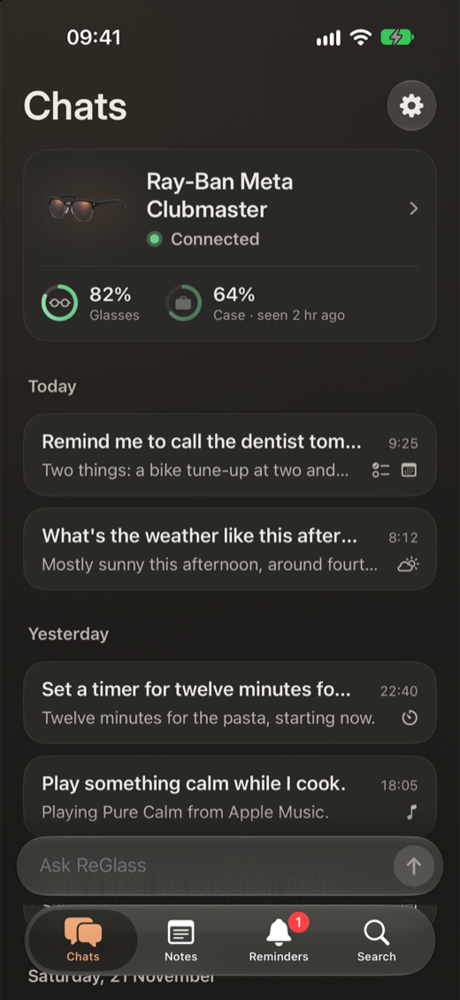
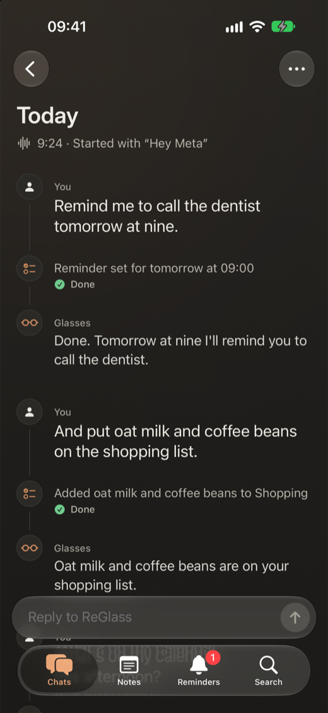
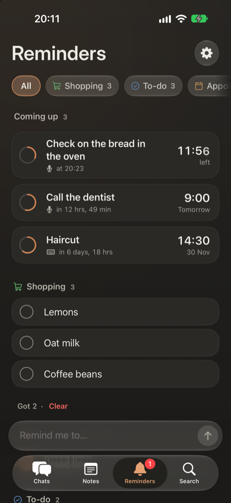
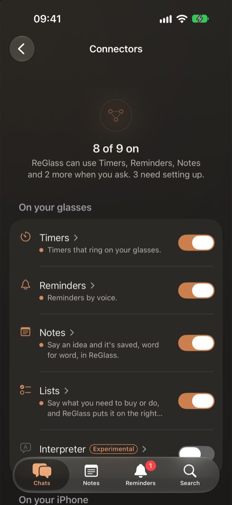
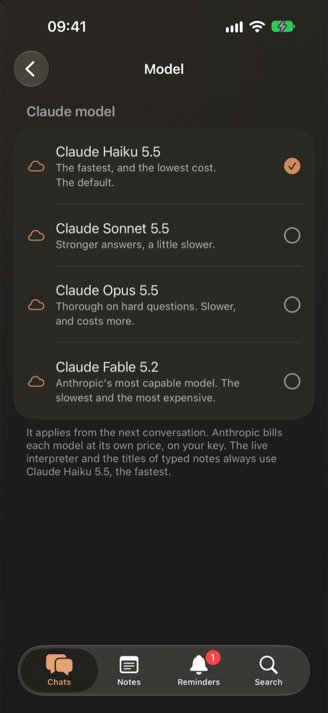
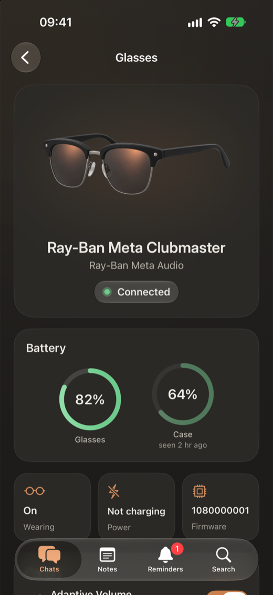

# ReGlass

Build your own Claude voice assistant for Ray-Ban Meta glasses on iPhone.

[](LICENSE)
[](docs/GETTING-STARTED.md)

## Before you start

ReGlass is an open-source, developer-oriented project. It was tested on one pair of Ray-Ban Meta Clubmaster (Audio) glasses.
You build and sign the app in Xcode with your own signing team. Setup needs your Meta sign-in and client values from
your own copy of the Meta AI Android app. The assistant needs your own Anthropic API key.

Setup uses Meta's signed hand-over to make ReGlass the owner app for your glasses. You can switch back by setting
them up again in Meta AI. Sign-in, setup and downloads can break when Meta changes its services.

Meta's terms don't permit third-party apps to use these values. Using them may breach those terms, and Meta could
restrict your account. [Meta client tokens and risks](docs/META-CREDENTIALS.md)

## Screenshots

These screenshots show sample data.

<table>
  <tr>
    <td align="center" valign="top">
      <br>
      <strong>Chats</strong><br>Your glasses' status and recent conversations.
    </td>
    <td align="center" valign="top">
      <br>
      <strong>Conversation</strong><br>What you asked and what ReGlass did.
    </td>
    <td align="center" valign="top">
      <br>
      <strong>Reminders</strong><br>Reminders and lists by voice.
    </td>
  </tr>
  <tr>
    <td align="center" valign="top">
      <br>
      <strong>Connectors</strong><br>Choose what the assistant can reach.
    </td>
    <td align="center" valign="top">
      <br>
      <strong>Model</strong><br>Pick the Claude model.
    </td>
    <td align="center" valign="top">
      <br>
      <strong>Glasses</strong><br>Battery, case and status at a glance.
    </td>
  </tr>
</table>

## What it does

- Connects directly over encrypted Bluetooth with ReGlass's own key. Shows battery, case, charging and wearing
  status, and reconnects in the background without contacting Meta.
- Answers when you say "Hey Meta" or touch and hold the touchpad. Replies start playing as they're written. Ask a
  follow-up without the wake word, or say "Hey Meta" during a reply to stop it. You can also type requests in Chats.
- Uses Claude for answers and web search. Choose Haiku 5.5 (the default), Sonnet 5.5, Opus 5.5 or Fable 5.2 in
  **Settings → Assistant → Model**.
- Uses Apple's on-device speech recognition and voice by default. ElevenLabs Scribe and ElevenLabs voices are
  optional. The experimental live interpreter translates speech in about 30 languages into English in your glasses.
- Saves conversations in Chats and lets you create notes, reminders and lists by voice or by typing. Search across
  Chats, Notes and Reminders, organise your library with categories, and recover items from Recently Deleted.
- Lets you turn connectors on or off for timers that ring on the glasses, ReGlass reminders and lists, notes,
  Calendar, Alarms, Apple Music and Weather. Web search needs no switch.
- Downloads and verifies the factory wake word files for your firmware from Meta, or imports a set you already have.
  Installing asks for confirmation separately. ReGlass ships no wake word files.
- Finds and installs Meta's signed firmware updates on the Clubmaster (Audio) and shows progress as they run.

## Requirements and building

- **An iPhone running iOS 27 or newer** and **a Mac with Xcode 27 or newer** and the iOS 27 SDK.
- **An Apple signing team.** A free Personal Team may be enough for the default build. This is unconfirmed.
  iCloud sync and searching the full Apple Music catalogue need a paid Apple Developer Program membership.
- **Ray-Ban Meta glasses** and the Meta account that owns them. See [tested hardware and firmware](docs/COMPATIBILITY.md).
- **Your own copy of Meta AI for Android** and **Python 3.9 or newer** for the helper in `tools/meta-tokens/`.
- **An Anthropic API key.** An ElevenLabs API key is optional for voice and speech recognition and required for
  the interpreter.

The repository includes the generated Xcode project. Use XcodeGen if you change `project.yml` or add or remove
source files. [Build and signing guide](docs/GETTING-STARTED.md)

## Quick start

Clone the repository, then follow the guide to configure signing, run the Meta token script, build on your
iPhone and set up the glasses. [Getting started](docs/GETTING-STARTED.md)

```sh
git clone https://github.com/cro13/reglass.git
cd reglass
```

## How it works

The glasses and ReGlass on your iPhone talk over encrypted Bluetooth. The app uses Claude for answers, Apple for
on-device voice and speech by default, and ElevenLabs if you enable it or use the interpreter. ReGlass connects to
Meta's services for sign-in, the signed ownership hand-over, firmware updates and factory wake word downloads.

## FAQ

**Can I go back to Meta AI?** Yes. Forget the glasses in ReGlass or turn off **Stay connected**, then set up the
glasses again in Meta AI. [Ownership](docs/OWNERSHIP.md)

**Why isn't it on the App Store?** ReGlass is published as source for developers to build and sign themselves.
There is no App Store build or IPA.

**Is my data sent anywhere?** Claude receives your requests and any context needed to answer. Optional services
receive the data needed for the features you use. API keys are stored in the iPhone's Keychain. Chats and your
library live on your iPhone, with library sync available in a build you configure for iCloud. ReGlass has no
analytics. [Privacy](docs/PRIVACY.md)

**Which glasses work?** One Ray-Ban Meta Clubmaster (Audio) pair was tested on firmware 1082194281 and 1086324946.
Other models and builds may behave differently. [Compatibility](docs/COMPATIBILITY.md)

## Documentation

- Setup and help · [Getting started](docs/GETTING-STARTED.md), [Using ReGlass](docs/USING.md),
  [Troubleshooting](docs/TROUBLESHOOTING.md), [Ownership](docs/OWNERSHIP.md), [Privacy](docs/PRIVACY.md)
- Glasses · [Capabilities](docs/GLASSES.md), [Compatibility](docs/COMPATIBILITY.md),
  [Wake word](docs/WAKE-WORD.md), [Firmware updates](docs/FIRMWARE.md)
- Assistant and library · [Connectors](docs/CONNECTORS.md), [Voice and speech](docs/VOICE.md),
  [Live interpreter](docs/INTERPRETER.md), [iCloud sync](docs/ICLOUD.md)
- Development · [Meta client tokens](docs/META-CREDENTIALS.md), [Token helper](tools/meta-tokens/README.md),
  [Architecture](docs/ARCHITECTURE.md), [ReGlassKit design](ReGlassKit/DESIGN.md), [Design](docs/DESIGN.md),
  [Roadmap](docs/ROADMAP.md), [Changelog](CHANGELOG.md)

## Contributing and security

Bug reports, compatibility results and contributions are welcome. [Contributing](CONTRIBUTING.md)

Use GitHub's private vulnerability reporting for security issues. [Security policy](SECURITY.md)

## Legal and trademarks

ReGlass is for interoperability with hardware you own. It distributes no Meta code or firmware. The glasses verify
Meta's signatures themselves.

ReGlass is not affiliated with, endorsed by or sponsored by Meta, EssilorLuxottica, Anthropic or ElevenLabs.

Meta, Meta AI and "Hey Meta" are trademarks of Meta Platforms, Inc. Ray-Ban and Clubmaster are trademarks of their
owners in the EssilorLuxottica group. Claude and Anthropic are trademarks of Anthropic, PBC. ElevenLabs is a trademark
of ElevenLabs. Apple, iPhone, iOS and Xcode are trademarks of Apple Inc. The names are used only to say what ReGlass
works with.

## License and credits

ReGlass (pronounced "ree-glass") is free software under the GNU Affero General Public License v3.0. [License](LICENSE)

ReGlass builds on libopus, swift-opus, Inter Display and Phosphor Icons. [Third-party components](THIRD_PARTY.md)
